  

  

  
  
  
  

---

## 👩‍💻 About Me

<table>
<tr>
<td width="58%" valign="top">

I'm a **Software Engineering student at Nişantaşı University**, based in **İstanbul**. I enjoy building web applications with **Laravel & PHP** and exploring software development with **Python** and **Java**.

I'm currently **looking for an internship** where I can contribute to real projects, learn from experienced engineers and grow as a developer.

- 🔭 Working on **web development projects with Laravel & PHP**
- 🌱 Learning **advanced concepts in Python and Java**
- 👯 Open to collaborating on **open-source web projects**
- 💬 Ask me about **PHP, Laravel, Python, Java & web development**
- ⚡ Fun fact: **I love turning ideas into real, working apps**

</td>
<td width="42%" align="center">
  
</td>
</tr>
</table>

## 🎯 What I Bring to an Internship

| | |
|---|---|
| 🧱 **Backend fundamentals** | MVC architecture, routing, Eloquent ORM, REST concepts with Laravel |
| 🗄️ **Databases** | Designing tables and writing queries with MySQL |
| 🐍 **Problem solving** | Algorithms and scripting with Python, OOP with Java |
| 🤝 **Team-ready** | Git workflow, clean code habits, eager to learn and take feedback |

## 🛠️ Tech Stack & Tools

  

<b>Show as badges</b>

 

**Languages**

**Frameworks & Web**

**Database & Tools**

## 📊 GitHub Stats

  
  

  

  

## 🐍 Contribution Snake

  <picture>
    <source media="(prefers-color-scheme: dark)" srcset="https://raw.githubusercontent.com/silanaybek/silanaybek/output/github-contribution-grid-snake-dark.svg"/>
    <source media="(prefers-color-scheme: light)" srcset="https://raw.githubusercontent.com/silanaybek/silanaybek/output/github-contribution-grid-snake.svg"/>
    
  </picture>

## 📫 Let's Connect

  
  

  

